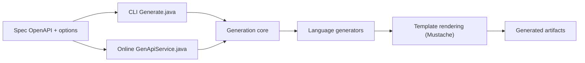

# OpenAPITools/openapi-generator

> Génère clients SDK, stubs serveur et documentation depuis une spec OpenAPI, pour équipes API multi-langages.

## Le problème
Écrire à la main les clients et squelettes serveur de chaque API, dans chaque langage, puis les maintenir alignés avec la spec.

## Ce que ça fait vraiment
À partir d'une spec OpenAPI (2.0, 3.0, 3.1 en bêta), produit des clients, des stubs serveur, de la doc (HTML, Markdown, AsciiDoc…) et d'autres artefacts (Postman, GraphQL, protobuf…). Les générateurs reposent sur des templates Mustache personnalisables (`-t`). Il existe en CLI (JAR Java 11+), plugin Maven/Gradle/Mill, image Docker, paquet npm ou pip, et service web.

## Comment c'est branché


## Essayer
```bash
docker run --rm -v "${PWD}:/local" openapitools/openapi-generator-cli generate \
    -i https://raw.githubusercontent.com/openapitools/openapi-generator/master/modules/openapi-generator/src/test/resources/3_0/petstore.yaml \
    -g go \
    -o /local/out/go
```

## Coût et pièges
Gratuit ; il faut un runtime Java 11 (ou Docker). Le README avertit : une spec ou un template d'origine non fiable peut provoquer de l'injection de code dans le code généré.

## Ce que ce n'est pas
Pas affilié à l'OpenAPI Initiative. Le code généré varie en qualité selon les générateurs ; 5 793 issues ouvertes. Les générateurs « expérimentaux » ne sont pas tous au même niveau.

## Alternatives
- Swagger Codegen : l'ancêtre dont le projet est un fork (guide de migration fourni).

## Pour toi
À adopter dès que tu dois exposer ou consommer une API REST dans plusieurs langages (client Python pour un service ML, par exemple) : maintenu, licence Apache-2.0, énorme base d'utilisateurs.

