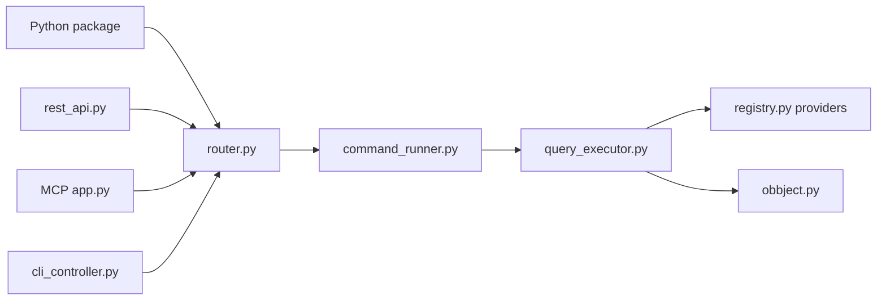

# OpenBB-finance/OpenBB

> A Python layer that unifies various financial data sources and exposes them through Python, REST, command-line interface (CLI), and Microsoft Common Language Runtime (MCP).

## The problem
Each financial data provider has its own API, its own format, and its own authentication method; these need to be integrated for each tool that consumes them.

## What it actually does
`obb.equity.price.historical("AAPL")` returns a normalized result that can be converted into a DataFrame. The process involves a router (`router.py`), an executor (`command_runner.py`), and a query executor (`query_executor.py`) chosen from a registry (`registry.py`), and then returns as a result object (`obbject.py`).

The same data is also provided by a FastAPI API (`openbb-api`, port 6900), a CLI (`openbb-cli`), and an MCP server for agents. The backend also connects to OpenBB Workspace, the commercial interface.

## How it is wired


## Trying it
```bash
pip install openbb
pip install "openbb[all]"
openbb-api
pip install openbb-cli
```

## Cost and gotchas
Free library, Python 3.9.21 to 3.12. Some providers are "owned or licensed": you are responsible for managing your access. OpenBB Workspace requires an account.

## What it is not
Not a data source: a connector. The README specifies that the data may not be accurate, and that OpenBB takes no responsibility. The analysis interface is not here; it's Workspace.

## Alternatives
No alternative is specified in the README.

## For you
Keep an eye on this if you're working with finance; their MCP data server is a good model to emulate.
