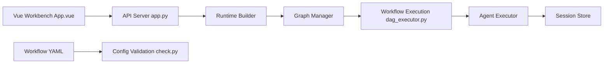

# OpenBMB/ChatDev

> No-code LLM multi-agent orchestration platform, configured in YAML, for prototyping workflows.

## The problem
Building a multi-agent system means hand-writing the orchestration, the loops and the state management.

## What it actually does
ChatDev 2.0 (DevAll): a FastAPI backend (`server/`) plus a Vue 3 console with a visual canvas to define agents, nodes and flows.
The runtime validates the config, builds the graph (cycles included), executes it as a DAG, calls models, skills and tools, and archives sessions and artifacts.
Workflows provided in `yaml_instance/`: data visualization, 3D Blender, deep research, video game, educational video.
Python SDK (`chatdev` on PyPI); ChatDev 1.0 ("virtual company") kept as legacy.

## How it is wired


## Trying it
```bash
uv sync
cd frontend && npm install
cp .env.example .env
make dev
docker compose up --build
```

## Cost and gotchas
`API_KEY` and `BASE_URL` of an LLM provider are required: every multi-agent workflow consumes a lot of tokens. Python 3.12+, Node 18+, uv.

## What it is not
Not a reliable "turnkey" software generator; the 3D workflows require Blender and blender-mcp. Governance not specified (academic lab OpenBMB assumed).

## Alternatives
No alternative named in the README (OpenClaw is cited as a client, not as a competitor).

## For you
A good playground for declarative agent pipelines; watch the token bill.
