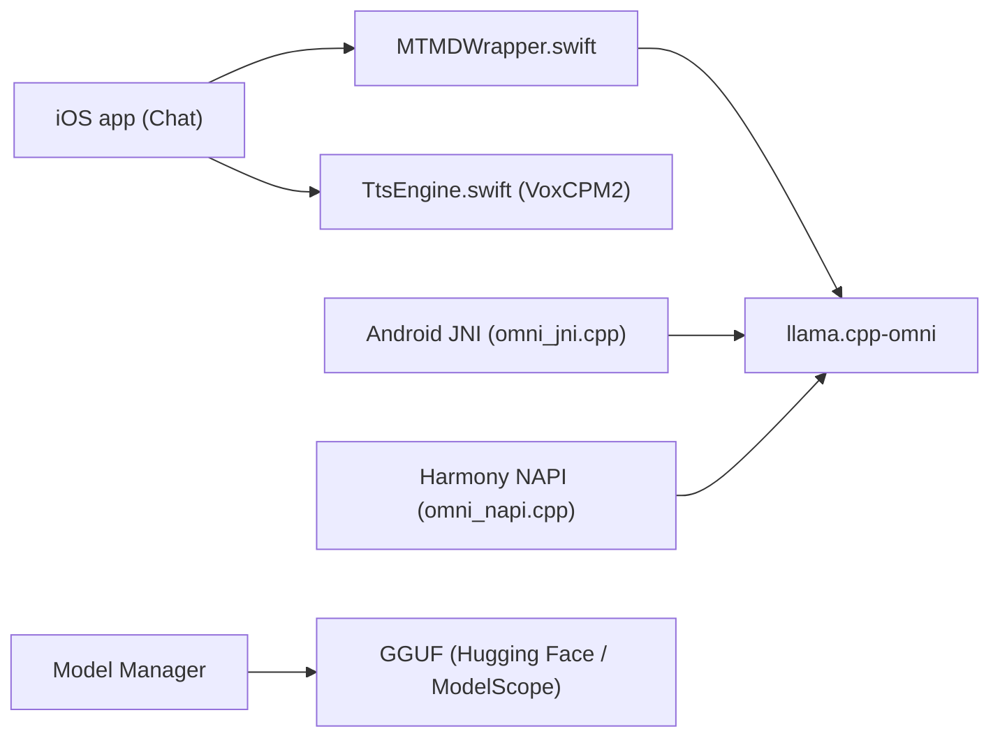

# OpenBMB/MiniCPM-V-Apps

> iOS, Android and HarmonyOS demos that run MiniCPM-V models entirely on the device via llama.cpp.

## The problem
Running a multimodal model locally on a phone, with no server and no data sent out, requires a llama.cpp port and native applications.

## What it actually does
Three applications (Xcode, Gradle/Kotlin, DevEco/ArkTS) share the `llama.cpp-omni` submodule. They handle text, image and video chat, real-time camera capture, a speech synthesis screen (VoxCPM2) and a model manager that downloads GGUF files. Supported models: MiniCPM-V 2.6, 4.0 and 4.6, MiniCPM5 1B and 2B (text only), VoxCPM2. Native bridges: `MTMDWrapper.swift`, `omni_jni.cpp`, `omni_napi.cpp`.

## How it is wired


## Trying it
```bash
git clone --recurse-submodules --shallow-submodules https://github.com/OpenBMB/MiniCPM-V-Apps.git
./scripts/build_xcframework.sh
cd MiniCPM-V-demo-Android
./gradlew assembleDebug
```

## Cost and gotchas
An Apple or Huawei account is needed to deploy to a device. Recommended RAM of 4 to 8 GB depending on the model (V 2.6: 8 GB or more). Default context of 4K tokens. The submodule weighs about 350 MB in a full clone. No license declared on the repository.

## What it is not
Not a published application: these are demos to compile, even though a DOWNLOAD.md points to prebuilt packages. The weights have their own licenses, not detailed here.

## Alternatives
No alternative named in the README.

## For you
Worth watching: a good starting point for embedded multimodal inference on mobile, but the absence of a license blocks any reuse at this stage.
