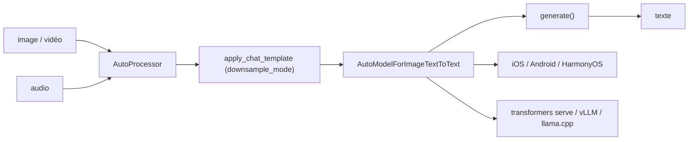

# OpenBMB/MiniCPM-V

> Series of compact multimodal models for image, video and voice, deployable on a phone.

## The problem
Usable vision-language models require a server GPU: nothing runs on the device.
Visual encoding costs more than text and makes the number of tokens explode.

## What it actually does
MiniCPM-V 4.6: 1.3 billion parameters, built on SigLIP2-400M and Qwen3.5-0.8B, mixed 4x/16x visual compression.
Early intra-ViT compression (LLaVA-UHD v4) cuts the compute cost of visual encoding by more than half.
MiniCPM-o 4.5: 9 billion parameters, end-to-end, incoming video and audio streams with simultaneous text and voice output, without mutual blocking.
Voice cloning from a reference clip, document parsing, more than 30 languages; quantized variants GGUF, BNB, AWQ, GPTQ.

## How it is wired


## Trying it
```bash
pip install "transformers[torch]>=5.7.0" torchvision torchcodec
pip install "transformers[serving]>=5.7.0"
transformers serve openbmb/MiniCPM-V-4.6 --port 8000 --host 0.0.0.0 --continuous-batching
pip install "transformers==4.51.0" accelerate "torch>=2.3.0,<=2.8.0" "torchaudio<=2.8.0" "minicpmo-utils[all]>=1.0.5"
```

## Cost and gotchas
`torchcodec` breaks depending on the CUDA version: fall back to PyAV or pin the matching PyTorch index.
MiniCPM-o 4.5 requires exactly `transformers==4.51.0`, incompatible with the 5.7+ stack of MiniCPM-V 4.6: two separate environments.
FFmpeg is required for video frame extraction and duplex video generation.

## What it is not
It is not a single model: two families with incompatible dependencies coexist in the same repository.
They are not neutral comparisons: some of the competitors' scores come from the authors' own evaluation (marked with an asterisk).
The README does not declare the license of the weights; it is truncated in the middle of the FFmpeg installation instructions.

## Alternatives
Qwen3-VL-8B, Qwen3-Omni-30B: compared throughout the README, bigger and more expensive to serve.
DeepSeek-OCR 2, dots.ocr, HunyuanOCR: cited for document parsing, preferable if that is the only need.

## For you
Worth testing for OCR or local video understanding at low GPU cost — check the weights license before any client use.
