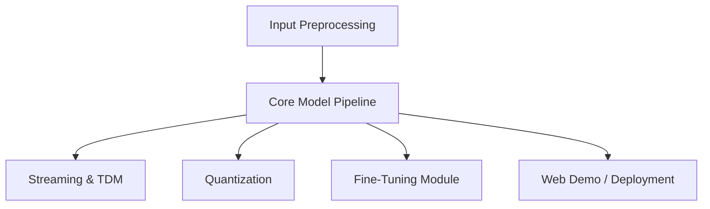

# OpenBMB/MiniCPM-o

> Compact multimodal models: MiniCPM-V 4.6 (1.3B) for image and video, MiniCPM-o 4.5 (9B) for live voice.

## The problem
Running vision, voice and video on a personal device without a big server.

## What it actually does
V 4.6 understands images and videos, with 4x/16x visual token compression and adaptation code for iOS, Android, HarmonyOS. o 4.5 processes continuous video and audio streams and produces text and speech at the same time (full duplex), with voice cloning. Inference via transformers, vLLM, SGLang, llama.cpp, Ollama; fine-tuning with LLaMA-Factory or SWIFT; quantized variants.

## How it is wired


## Trying it
```bash
pip install "transformers[torch]>=5.7.0" torchvision torchcodec
transformers serve openbmb/MiniCPM-V-4.6 --port 8000 --host 0.0.0.0 --continuous-batching
```

## Cost and gotchas
V 4.6: 4 GB of GPU announced; o 4.5: 19 GB (28 GB for the PyTorch web demo). transformers versions strictly pinned (5.7 or 4.51 depending on the model). Scores come from the README.

## What it is not
Duplex mode remains unstable (listed limitations: wrong voice, language mixing). The README disclaims any responsibility for generated content.

## Alternatives
- Qwen3-Omni-30B-A3B: compared in the README tables.
- PaddleOCR-VL and MinerU 2.5: compared for document parsing.

## For you
Worth watching: a good lightweight local VLM candidate, to evaluate on your data; the license is not declared in the catalog.
