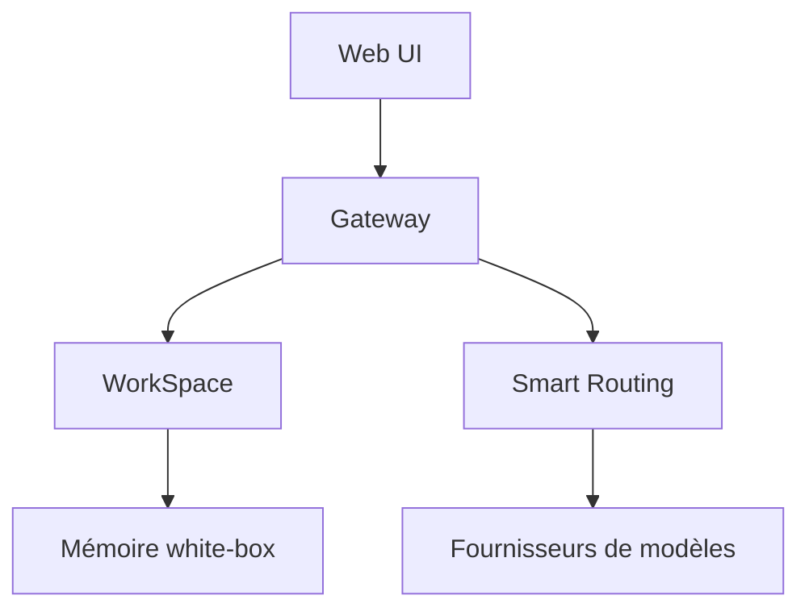

# OpenBMB/PilotDeck

> AI agent platform organized by workspaces, with editable memory and model routing.

## The problem
Agents mix projects in a shared context, memory is opaque and the token cost is unknown.

## What it actually does
Each project has its own files, memory and skills. Memory is visible and editable, a "dream" mode consolidates it and allows rollback. Routing sends hard tasks to a strong model and simple ones to a lightweight model. Background tasks run while you are away, with MCP, plugins and hooks. Web interface.

## How it is wired
Simplified diagram based on the sheet, no diagram provided.


## Trying it
```bash
curl -fsSL https://raw.githubusercontent.com/OpenBMB/PilotDeck/main/install.sh | bash
pilotdeck
docker compose up -d --build
```

## Cost and gotchas
Node.js 22.13+ and below 23 required. Model provider and API key at your expense (local Ollama possible). The cost and score figures come from the authors.

## What it is not
Not a model: an agent harness. The announced gains (about 70% savings) are internal measurements, not verified here. Repository less than six months old.

## Alternatives
Claude Code: better score on some categories in the README table. WorkBuddy: cited, but rated lower.

## For you
Worth watching: inspectable memory and cost routing are useful ideas, but the project is young and under AGPL.
