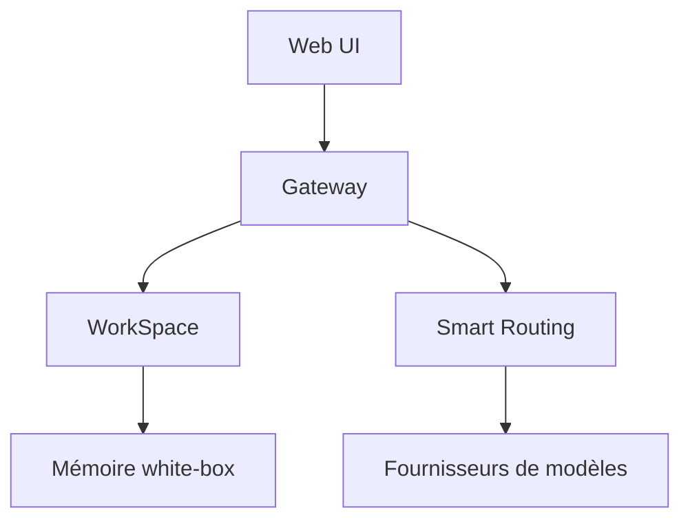

# OpenBMB/PilotDeck

> Plateforme d'agent IA organisée par espaces de travail, avec mémoire éditable et routage de modèles.

## Le problème
Les agents mélangent les projets dans un contexte commun, la mémoire est opaque et le coût en jetons est inconnu.

## Ce que ça fait vraiment
Chaque projet a ses fichiers, sa mémoire et ses compétences. La mémoire est visible et modifiable, un mode « rêve » la consolide et permet un retour arrière. Un routage envoie les tâches difficiles à un modèle fort et les simples à un modèle léger. Des tâches de fond tournent hors présence, avec MCP, greffons et hooks. Interface web.

## Comment c'est branché
Schéma simplifié d'après la fiche, sans diagramme fourni.


## Essayer
```bash
curl -fsSL https://raw.githubusercontent.com/OpenBMB/PilotDeck/main/install.sh | bash
pilotdeck
docker compose up -d --build
```

## Coût et pièges
Node.js 22.13+ et sous 23 exigé. Fournisseur de modèle et clé d'API à ta charge (Ollama local possible). Les chiffres de coût et de score viennent des auteurs.

## Ce que ce n'est pas
Pas un modèle : un harnais d'agent. Les gains annoncés (environ 70 % d'économie) sont des mesures internes, non vérifiées ici. Dépôt de moins de six mois.

## Alternatives
Claude Code : meilleur score sur certaines catégories dans le tableau du README. WorkBuddy : cité, mais moins bien noté.

## Pour toi
À surveiller : la mémoire inspectable et le routage de coût sont des idées utiles, mais le projet est jeune et en AGPL.

