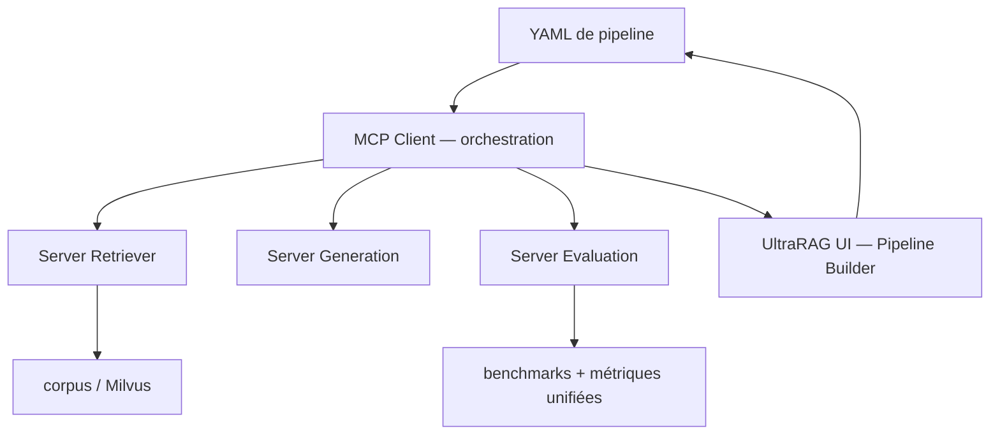

# OpenBMB/UltraRAG

> YAML-orchestrated RAG framework, where every component is an MCP server.

## The problem
An iterative RAG — loops, conditional branches, query rewriting — is usually coded in hundreds of lines of glue.
Comparing two variants on a benchmark takes even more plumbing.

## What it actually does
Components (Retriever, Generation, etc.) are independent MCP servers; an MCP client orchestrates sequences, loops and branches described in YAML.
Adding a feature amounts to registering it as a Tool: it enters workflows without touching the rest.
Standardized evaluation workflows and ready-to-use research benchmarks make it possible to compare baselines with unified metrics handling.
The UI is a visual IDE: Pipeline Builder with two-way canvas ↔ code synchronization, an AI assistant for structure and prompts, one-click conversion of a pipeline into a conversational Web UI.

## How it is wired


## Trying it
```bash
git clone https://github.com/OpenBMB/UltraRAG.git --depth 1
cd UltraRAG
uv sync --all-extras
source .venv/bin/activate
ultrarag run examples/experiments/sayhello.yaml
# ou en Docker :
docker run -it --gpus all -p 5050:5050 hdxin2002/ultrarag:v0.3.0
```

## Cost and gotchas
Free, but the full installation locks the Linux GPU dependencies to CUDA 12.9, vLLM cu129 wheel included: you need the right machine.
Production deployment assumes you set up a Retriever, an LLM and a Milvus vector database yourself.

## What it is not
Not a finished product: the stated positioning is "research exploration and industrial prototyping", carried by THUNLP, NEUIR, OpenBMB and AI9stars.
Nor is it lightweight despite the slogan: the "core" installation only runs the UI, the rest comes through extras.

## Alternatives
- AgentCPM-Report: the companion 8B model, if your need is long-form reports rather than the framework.
- MiniCPM-Embedding-Light: the in-house embedding cited in the publications.

## For you
The right ground to cleanly compare RAG variants; the visual IDE and MCP make it a heavy piece for production.
