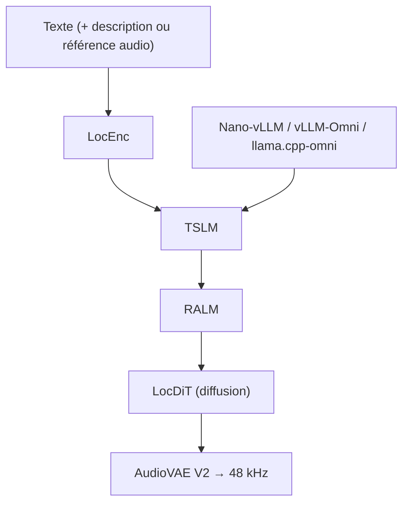

# OpenBMB/VoxCPM

> Tokenizer-free text-to-speech model, 30 languages, voice cloning and voice design.

## The problem
TTS systems that go through discrete tokenization lose nuances of timbre and prosody,
and most open models remain bilingual and limited in audio quality.

## What it actually does
Directly generates continuous speech representations through a diffusion autoregressive
architecture, with no discrete tokenization. VoxCPM2 has 2 billion parameters, trained on more
than 2 million hours, on a MiniCPM-4 backbone.
Accepts text in 30 languages with no language tag, plus nine Chinese dialects.
Creates a voice from a natural-language description (Voice Design), clones a voice from
a short clip with optional control of emotion and pace, or reproduces every nuance by
supplying a clip and its transcript (Ultimate Cloning).
Outputs 48 kHz from a 16 kHz reference via AudioVAE V2, with built-in super-resolution.
RTF of about 0.3 on an RTX 4090, ~0.13 with Nano-vLLM or vLLM-Omni.

## How it is wired


## Trying it
```bash
pip install voxcpm
voxcpm design --text "VoxCPM2 brings studio-quality multilingual speech synthesis." --output out.wav
voxcpm clone --text "This is a voice cloning demo." --reference-audio path/to/voice.wav --output out.wav
python app.py --port 8808
vllm serve openbmb/VoxCPM2 --omni --port 8000
```

## Cost and gotchas
Weights and code under Apache 2.0, free commercial use. A GPU is required: ~8 GB of VRAM for VoxCPM2,
Python ≥ 3.10 (< 3.13), PyTorch ≥ 2.5.0, CUDA ≥ 12.0. High-load serving goes through
Nano-vLLM or vLLM-Omni, which you must install and operate. On Apple Silicon, `--device auto` falls back to MPS.

## What it is not
It is not uniformly good across the 30 languages: the README's tables show heavily
degraded WER in Arabic, Czech, Hindi and Romanian, while voice similarity is often best in class.
It is not a product with guardrails: cloning a voice from a short clip raises
consent questions that the README does not address in the part read.

## Alternatives
The README cites other models only in its comparison tables: F5-TTS, CosyVoice2/3,
MaskGCT, IndexTTS2, Qwen3-TTS, FishAudio S2 — all measured, none recommended.

## For you
Worth keeping handy for local multilingual voice-over, if you have the card to go with it.
