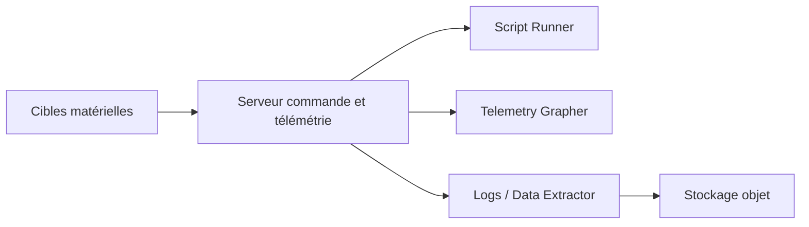

# OpenC3/cosmos

> Command and telemetry platform to test and operate embedded systems.

## The problem
Testing or operating embedded hardware requires custom interfaces, scripts and telemetry screens.

## What it actually does
- Sends commands to and receives telemetry from "targets" over TCP/IP, UDP or serial.
- Built-in tools: command and telemetry server, limits monitor, Ruby script runner, graphs, CSV extraction.
- Packet viewer, binary table editor, object storage explorer (Versitygw, S3, Google Cloud Storage).
- Documentation included, available offline.

## How it is wired
Simplified diagram based on the sheet, no diagram provided.

## Trying it
No command documented in the README: it points to the installation guide and the getting-started guide.

## Cost and gotchas
Free for the edition described. Installation not documented in the README. Active repository with many open issues (409). License present but not identified by GitHub.

## What it is not
Not a data or AI tool: it targets hardware testing and space. Not a mere viewer: it also sends commands to the devices.

## Alternatives
No alternative cited in the README.

## For you
Ignore: embedded systems domain, unrelated to your models or your data pipelines.
