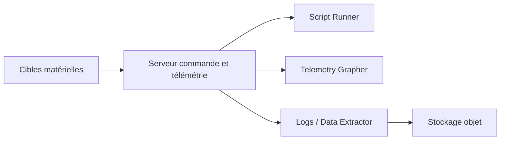

# OpenC3/cosmos

> Plateforme de commande et de télémétrie pour tester et piloter des systèmes embarqués.

## Le problème
Tester ou exploiter un matériel embarqué demande des interfaces, des scripts et des écrans de télémétrie sur mesure.

## Ce que ça fait vraiment
- Envoie des commandes et reçoit la télémétrie de « cibles » par TCP/IP, UDP ou série.
- Outils intégrés : serveur de commande et télémétrie, moniteur de limites, exécuteur de scripts Ruby, graphiques, extraction CSV.
- Visionneuse de paquets, éditeur de tables binaires, explorateur de stockage objet (Versitygw, S3, Google Cloud Storage).
- Documentation incluse, consultable hors ligne.

## Comment c'est branché
Schéma simplifié d'après la fiche, sans diagramme fourni.

## Essayer
Aucune commande documentée dans le README : il renvoie au guide d'installation et au guide de démarrage.

## Coût et pièges
Gratuit pour l'édition décrite. Installation non documentée dans le README. Dépôt actif avec de nombreuses issues ouvertes (409). Licence présente mais non identifiée par GitHub.

## Ce que ce n'est pas
Pas un outil data ou IA : il cible les essais de matériel et le spatial. Pas un simple visualiseur : il envoie aussi des commandes aux appareils.

## Alternatives
Aucune alternative citée dans le README.

## Pour toi
À ignorer : domaine des systèmes embarqués, sans lien avec tes modèles ni tes pipelines de données.

