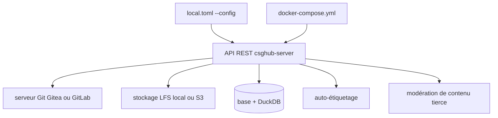

# OpenCSGs/csghub-server

> REST backend of a self-hosted platform for managing models and datasets.

## The problem
Hosting your own models and datasets requires a Git repository, LFS storage and a catalog: three systems to connect yourself.
Without a search and preview interface, nobody on the team can find what already exists.

## What it actually does
Manages users and organizations, with search across people, organizations, models and datasets.
Automatically tags models and datasets, and tracks their activity: downloads, likes.
Previews dataset files online, notably `.parquet`, and allows file-by-file download, LFS included.
Text and image content moderation can be enabled on demand by plugging in a third-party service.

## How it is wired


## Trying it
```shell
export STARHUB_SERVER_API_TOKEN=<API token>
mkdir -m 777 gitea minio_data
curl -L https://raw.githubusercontent.com/OpenCSGs/csghub-server/main/docker-compose.yml -o docker-compose.yml
docker-compose -f docker-compose.yml up -d
go run cmd/csghub-server/main.go start server --config local.toml
```

## Cost and gotchas
Announced resources: 4 CPU cores and 8 GB of memory, tested on Ubuntu 22.
The API token must be at least 128 characters long and travels as a Bearer on every HTTP request.
Content moderation is optional but requires a third-party service, hence an external cost.

## What it is not
Not the complete platform: it is the server side of CSGHub, without the interface.
Not a data warehouse: actual storage remains Git plus LFS on disk or S3.
Not an inference service: asset management says nothing about model deployment.

## Alternatives
No alternative named in the README; Gin, DuckDB, MinIO and Gitea are cited there as building blocks, not as substitutes.

## For you
Worth a look if you need to host a model catalog internally; the server-only version requires you to add the interface.
