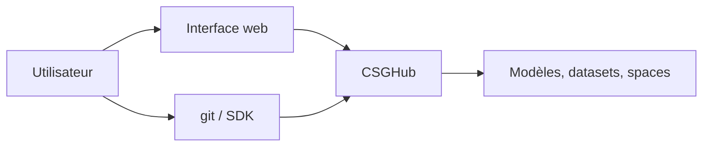

# OpenCSGs/csghub

> Self-hosted platform to manage LLM models, datasets and spaces, a private Hugging Face-style version.

## The problem
Storing, versioning and distributing LLM models and datasets internally, offline or without depending on a public service.

## What it actually does
Manages models, datasets, spaces and code via a web interface, `git` command line, chatbot or SDK. Offers open APIs, access control, multi-source synchronization and on-premises deployment. Installation documented with Docker Compose and Helm.

## How it is wired
Simplified diagram based on the sheet, no diagram provided.

## Trying it
No command documented in the README provided: it points to the official documentation (Docker Compose or Helm Chart) and to a free SaaS version.

## Cost and gotchas
On-premises deployment requires infrastructure. A free SaaS version exists on the OpenCSG site. The README does not quantify the required resources.

## What it is not
It is not Hugging Face itself: it is a private alternative. The README lists features without detailing their maturity.

## Alternatives
No alternative named in the README, apart from Hugging Face as a reference.

## For you
Worth watching if your team wants an offline private model hub; otherwise OpenCSG's SaaS or Hugging Face is enough.
