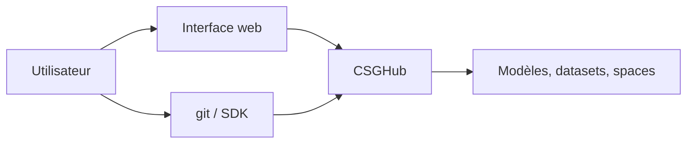

# OpenCSGs/csghub

> Plateforme auto-hébergée pour gérer modèles, jeux de données et espaces LLM, version privée façon Hugging Face.

## Le problème
Stocker, versionner et distribuer des modèles et jeux de données LLM en interne, hors ligne ou sans dépendre d'un service public.

## Ce que ça fait vraiment
Gère modèles, jeux de données, espaces et code via interface web, ligne de commande `git`, chatbot ou SDK. Propose des API ouvertes, un contrôle d'accès, des synchronisations multi-sources et un déploiement sur site. Installation documentée avec Docker Compose et Helm.

## Comment c'est branché
Schéma simplifié d'après la fiche, sans diagramme fourni.

## Essayer
Aucune commande documentée dans le README fourni : il renvoie à la documentation officielle (Docker Compose ou Helm Chart) et à une version SaaS gratuite.

## Coût et pièges
Le déploiement sur site demande de l'infrastructure. Une version SaaS gratuite existe sur le site d'OpenCSG. Le README ne chiffre pas les ressources nécessaires.

## Ce que ce n'est pas
Ce n'est pas Hugging Face lui-même : c'est une alternative privée. Le README liste des fonctions sans détailler leur maturité.

## Alternatives
Aucune alternative nommée dans le README, hormis Hugging Face comme référence.

## Pour toi
À surveiller si ton équipe veut un hub privé de modèles hors ligne ; sinon le SaaS d'OpenCSG ou Hugging Face suffit.

