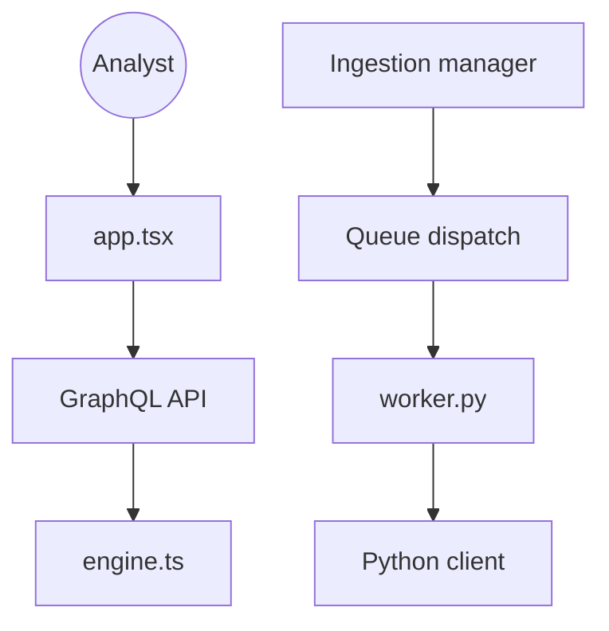

# OpenCTI-Platform/opencti

> Web platform to store, link and visualize cyber threat intelligence in STIX2 format.

## The problem
Cybersecurity analysts scatter indicators, reports and attributions across spreadsheets and tools with no links between them.

## What it actually does
Stores threat knowledge following a STIX2 schema, with sources, confidence levels and dates. Exposes a GraphQL API and a web interface. Connectors (MISP, TheHive, MITRE ATT&CK) and Python workers import data; exports as CSV and STIX2 bundles.

## How it is wired

## Trying it
No command in the README: installation (Docker, manual, community Terraform or Helm) is described in the official documentation. A public demo instance is reset every night.

## Cost and gotchas
Community edition under Apache 2; the Enterprise edition has its own license and paid features. Anonymous usage telemetry is collected. GitHub does not identify the repository's license.

## What it is not
Not a detection or blocking tool: it is a knowledge base. The README describes itself as in "intensive development"; more than 2,000 issues are open.

## Alternatives
No alternative named in the README (MISP and TheHive are cited as integrable tools).

## For you
Watch: relevant only if you do threat analysis; for AI applied to security, it provides a usable STIX2 graph.
