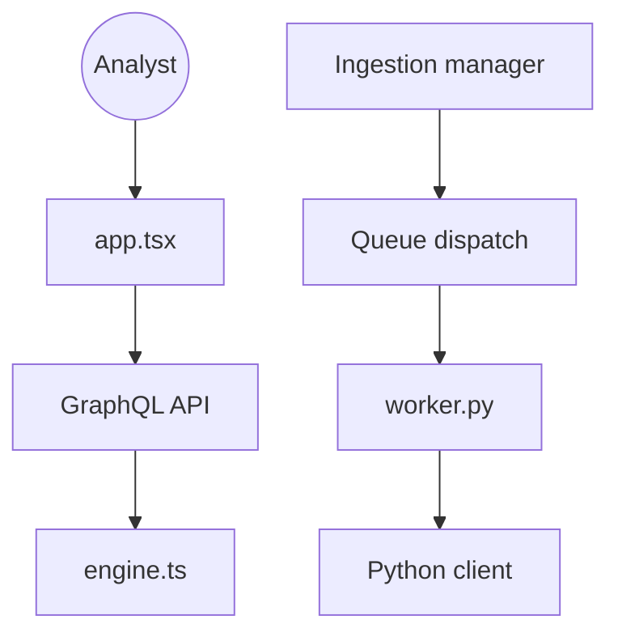

# OpenCTI-Platform/opencti

> Plateforme web pour stocker, relier et visualiser le renseignement sur les cybermenaces au format STIX2.

## Le problème
Les analystes en cybersécurité dispersent indicateurs, rapports et attributions dans des tableurs et outils sans liens entre eux.

## Ce que ça fait vraiment
Stocke la connaissance sur les menaces selon un schéma STIX2, avec sources, niveaux de confiance et dates. Expose une API GraphQL et une interface web. Des connecteurs (MISP, TheHive, MITRE ATT&CK) et des workers Python importent les données ; exports en CSV et bundles STIX2.

## Comment c'est branché

## Essayer
Aucune commande dans le README : l'installation (Docker, manuelle, Terraform ou Helm communautaires) est décrite dans la documentation officielle. Une instance de démonstration publique est réinitialisée chaque nuit.

## Coût et pièges
Édition communautaire sous Apache 2 ; l'édition Enterprise a sa propre licence et ses fonctions payantes. Une télémétrie d'usage anonyme est collectée. GitHub n'identifie pas la licence du dépôt.

## Ce que ce n'est pas
Pas un outil de détection ou de blocage : c'est une base de connaissance. Le README se dit en « développement intensif » ; plus de 2 000 issues sont ouvertes.

## Alternatives
Aucune alternative nommée dans le README (MISP et TheHive sont cités comme outils intégrables).

## Pour toi
À surveiller : pertinent seulement si tu fais de l'analyse de menaces ; pour de l'IA appliquée à la sécurité, il fournit un graphe STIX2 exploitable.

