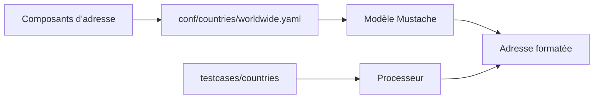

# OpenCageData/address-formatting

> Language-independent address formatting templates and test cases for 251 territories.

## The problem
Display an address according to the local convention from its components (street, city, postal code).

## What it actually does
Mustache templates and per-country YAML configuration, with `replace`, `postformat_replace`, `add_component`, `change_country`, `use_country` rules. Test cases per territory. Processors exist for about ten languages (Python and Rust unmaintained). Does not handle floors, PO boxes or translation.

## How it is wired


## Trying it
```bash
bin/coverage.pl
bin/coverage.pl -d
```

## Cost and gotchas
Free (MIT). Designed for display, not for postal mailing; per-language abbreviations are left to complete.

## What it is not
Not a geocoder or an address validator.

## Alternatives
No alternative named in the README (OpenCage Geocoder is the same authors' service).

## For you
Watch: a useful rule base if you normalize addresses in a data pipeline.
