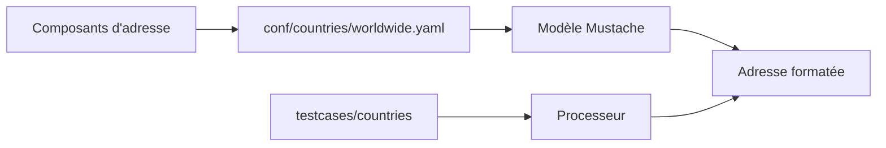

# OpenCageData/address-formatting

> Modèles et cas de test de mise en forme d'adresses pour 251 territoires, indépendants du langage.

## Le problème
Afficher une adresse selon la convention locale à partir de composants (rue, ville, code postal).

## Ce que ça fait vraiment
Modèles Mustache et configuration YAML par pays, avec règles `replace`, `postformat_replace`, `add_component`, `change_country`, `use_country`. Cas de test par territoire. Des processeurs existent pour une dizaine de langages (Python et Rust non maintenus). Ne gère pas étages, boîtes postales ni traduction.

## Comment c'est branché


## Essayer
```bash
bin/coverage.pl
bin/coverage.pl -d
```

## Coût et pièges
Gratuit (MIT). Prévu pour l'affichage, pas pour l'envoi postal ; abréviations par langue à compléter.

## Ce que ce n'est pas
Pas un géocodeur ni un validateur d'adresses.

## Alternatives
Aucune alternative nommée dans le README (OpenCage Geocoder est le service des mêmes auteurs).

## Pour toi
À surveiller : base de règles utile si tu normalises des adresses dans un pipeline de données.

