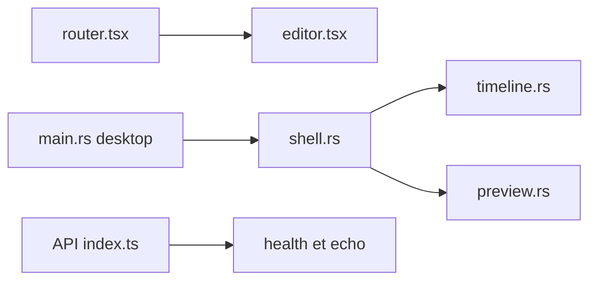

# OpenCut-app/OpenCut

> Free video editor for web, desktop and mobile, undergoing a complete rewrite.

## The problem
Video editors are either paid or tied to a system, and hard to automate.

## What it actually does
The README announces a rewrite: editing API, plugins, a single Rust core, MCP server, headless mode and a scripts tab. The sampled code is only a skeleton: web routes (home, editor), a desktop shell with panels (browser, inspector, preview, timeline) and an API that only returns health and echo. The announced features are yet to come. The classic version lives in opencut-classic.

## How it is wired


## Trying it
```bash
bash <(curl -fsSL https://moonrepo.dev/install/proto.sh)
proto use
moon run web:dev
moon run api:dev
moon run desktop:dev
```

## Cost and gotchas
Free, MIT. Uses the proto tool to install versions. Last push on 2026-09-24. For real use, the README points to opencut-classic.

## What it is not
Not usable today: it is scaffolding. The plugins, MCP and headless outputs are only promises.

## Alternatives
opencut-classic, the previous version, is the one to use today according to the README.

## For you
Worth watching: the idea of a video editor with an MCP server and headless rendering is appealing, but there is nothing to use until the rewrite progresses.
