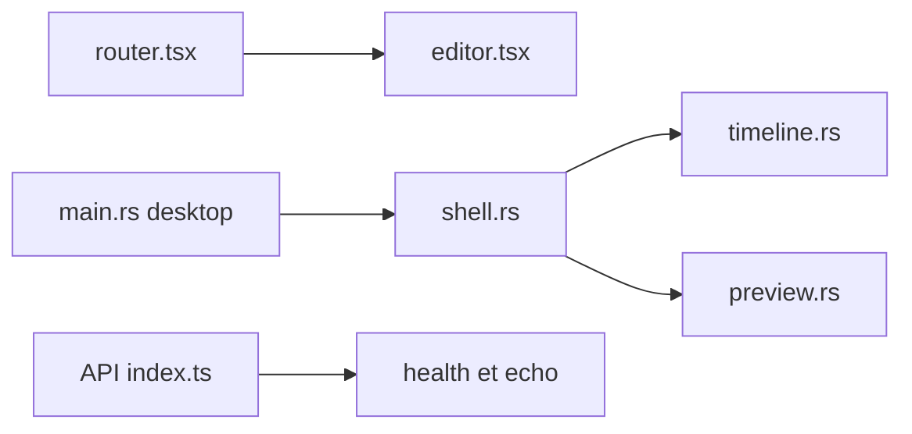

# OpenCut-app/OpenCut

> Éditeur vidéo libre pour web, desktop et mobile, en cours de réécriture complète.

## Le problème
Les éditeurs vidéo sont soit payants, soit liés à un système, et difficiles à automatiser.

## Ce que ça fait vraiment
Le README annonce une réécriture : API d'édition, plugins, cœur Rust unique, serveur MCP, mode sans interface et onglet de scripts. Le code échantillonné n'est qu'un squelette : routes web (accueil, éditeur), coque desktop avec panneaux (navigateur, inspecteur, aperçu, timeline) et une API qui ne renvoie que santé et écho. Les fonctions annoncées sont à venir. La version classique est dans opencut-classic.

## Comment c'est branché


## Essayer
```bash
bash <(curl -fsSL https://moonrepo.dev/install/proto.sh)
proto use
moon run web:dev
moon run api:dev
moon run desktop:dev
```

## Coût et pièges
Gratuit, MIT. Utilise l'outil proto pour installer les versions. Dernier push le 2026-09-24. Pour un usage réel, le README renvoie vers opencut-classic.

## Ce que ce n'est pas
Pas utilisable aujourd'hui : c'est un échafaudage. Les plugins, MCP et sorties sans interface ne sont que des promesses.

## Alternatives
opencut-classic, la version précédente, est celle à utiliser aujourd'hui selon le README.

## Pour toi
À surveiller : l'idée d'un éditeur vidéo avec serveur MCP et rendu sans interface est séduisante, mais rien à utiliser avant que la réécriture n'avance.

