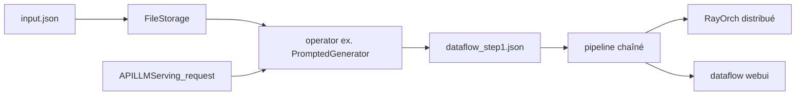

# OpenDCAI/DataFlow

> Operator system to generate, clean, evaluate and filter LLM training data.

## The problem
Preparing a training corpus from PDFs and noisy QA is craft work, not reproducible, and impossible to compare from one strategy to another.

## What it actually does
`operator`-based design: each operator takes JSON, JSONL or CSV, writes its output to a column, and composes into a reusable `pipeline`.
Ready-to-use pipelines: Text (QA extraction from raw text), Reasoning (chain-of-thought, classification, difficulty), Text2SQL, knowledge-base cleaning, Agentic RAG.
A DataFlow agent analyzes the data, writes operators and assembles pipelines according to the goal.
Companion suite: Skills, a visual WebUI, Ecosystem for operator registration, RayOrch for distributed orchestration.

## How it is wired


## Trying it
```shell
pip install uv
uv pip install open-dataflow
dataflow -v
dataflow webui
docker pull molyheci/dataflow:cu124
```

## Cost and gotchas
Generation operators call an LLM: `export DF_API_KEY=sk-xxx`, bill at your expense. Local inference goes through `open-dataflow[vllm]` and therefore a GPU; the Docker image bundles CUDA 12.4.1 and vLLM. Python 3.10 to 3.12.

## What it is not
Not a dataset: it is the tooling that produces them. Not a training framework: it prepares the data, training happens elsewhere (LLaMA-Factory, Megatron-DeepSpeed in their experiments). The announced gains come from their own benchmarks on their own datasets.

## Alternatives
Infinity-Instruct, Open-R1, Synthetic-1, Code Alpaca, Self-OSS — the comparison datasets in the tables, not competing frameworks.

## For you
The closest thing to a reproducible LLM data preparation chain; the Pipeline → Operator → Prompt model is directly reusable.
