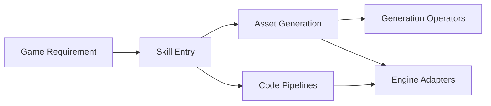

# OpenDCAI/GameFactory-3A

> Agent skills framework that generates assets, game code and videos for UE5, Unity, Godot, Blender and three.js.

## The problem
Making a game requires 3D assets, motion, sound and engine code that nobody coordinates automatically.

## What it actually does
A coding agent (Codex, Claude Code, Gemini CLI) reads `agent_skills/setting_overview.md`, then calls pipelines: images, 3D objects and scenes, motion, audio, CG video, game mechanics and interface. Adapters cover five engines. The demos cite Meshy, Hunyuan3D, Mixamo, Puppeteer and MoMask.

## How it is wired


## Trying it
```bash
# Dans un agent de code (Codex, Claude Code…) :
cd GameFactory-3A
# puis demander de lire agent_skills/setting_overview.md avant de décrire le jeu voulu
```

## Cost and gotchas
Heavy local models (GPU) or paid cloud APIs (Meshy, Seedance cited). Each engine has to be installed. The README gives no figure for VRAM or cost.

## What it is not
Not a one-click game generator: the result depends on the agent. The demos mix generated assets with free or library assets.

## Alternatives
No alternative named in the README.

## For you
Worth watching: interesting as an example of orchestrating an agent plus multimodal generation pipelines, but heavy and very recent (July 2026).
