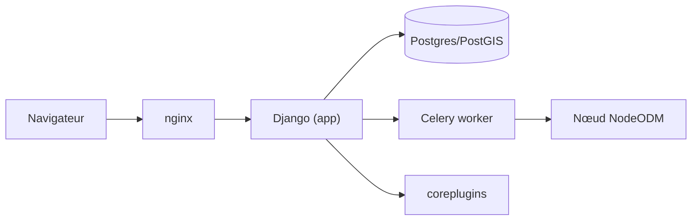

# OpenDroneMap/WebODM

> Web application that turns drone photos into maps, point clouds and 3D models, for cartographers.

## The problem
Processing aerial images (georeferencing, DEMs, textured models) requires heavy engines and a toolchain you do not want to drive by hand.

## What it actually does
A Django application with a web interface: you create a project, upload images, and a Celery task is queued and delegated to a processing node (NodeODM, ODX, MicMac, LGT) through a REST API. The results (orthophoto, point cloud, 3D model, Gaussian splats) come back in the interface. A plugin framework (`coreplugins`) extends the whole.

## How it is wired


## Trying it
```bash
# Commande non documentée dans l'extrait du README :
# installateurs officiels et documentation via les liens Download / Documentation.
```

## Cost and gotchas
Photogrammetric processing needs a lot of RAM and CPU ("Hardware Requirements" page). The README warns: since April 2026, paid third-party installers have been circulating; they are not the official ones.

## What it is not
It is no longer an OpenDroneMap interface: the project has officially split from it and uses ODX, not ODM. The AGPL license requires publishing the modifications of a network-exposed service.

## Alternatives
- ODX / NodeODM: the engine alone, if the web interface is superfluous.
- MicMac: another supported engine, for specific needs.

## For you
Watch: useful if you process aerial imagery, but unrelated to a data/AI/MLOps profile, and the recent split from OpenDroneMap changes the ecosystem.
