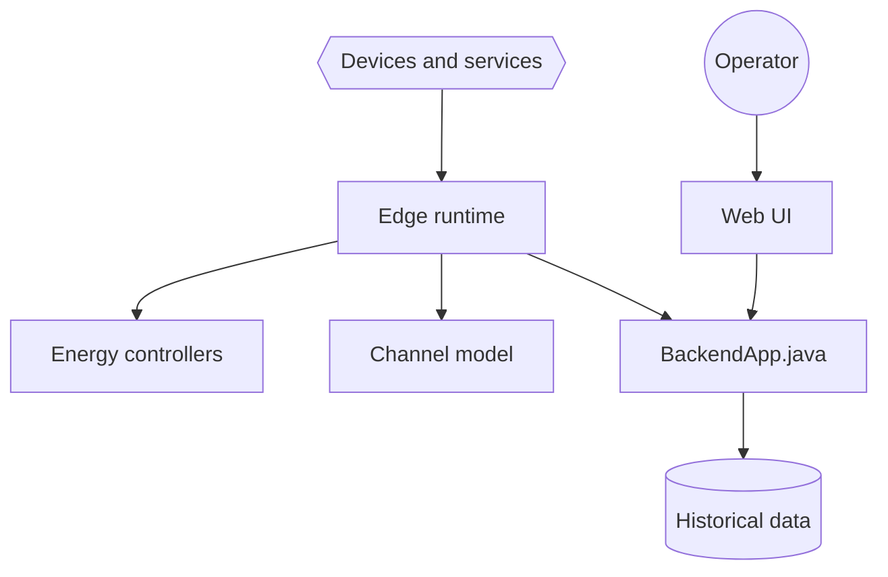

# OpenEMS/openems

> Modular energy management platform: storage, solar, charging stations, heat pumps.

## The problem
Controlling batteries, renewable generation and appliances together requires a common supervision and control layer.

## What it actually does
Three components: Edge (on site, communicates with devices, collects data, runs control algorithms), UI (browser and mobile) and Backend (cloud server that aggregates and monitors several Edges). The code also contains predictors, an application manager, OAuth authentication and metadata via Odoo.

## How it is wired

## Trying it
No command in the README: it points to a Gitpod demo and the Getting Started guide.

## Cost and gotchas
Free, AGPL-3.0 license. A real deployment requires hardware and energy protocols; the code is in Java, with a separate web interface.

## What it is not
Not a simple dashboard: it is a near-real-time control platform that acts on devices.

## Alternatives
No alternative named in the README.

## For you
Ignore, unless you have an energy optimization project: the predictors are interesting but buried in an industrial Java stack.
