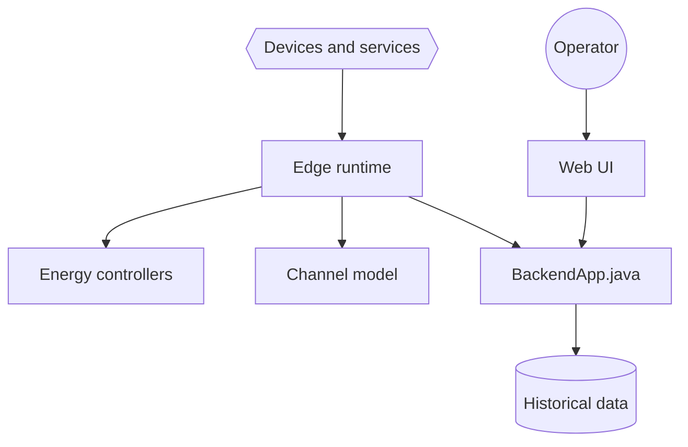

# OpenEMS/openems

> Plateforme modulaire de gestion d'énergie : stockage, solaire, bornes de recharge, pompes à chaleur.

## Le problème
Piloter ensemble batteries, production renouvelable et appareils demande une couche commune de supervision et de contrôle.

## Ce que ça fait vraiment
Trois composants : Edge (sur site, communique avec les appareils, collecte les données, exécute des algorithmes de contrôle), UI (navigateur et mobile) et Backend (serveur cloud qui agrège et surveille plusieurs Edge). Le code contient aussi des prédicteurs, un gestionnaire d'applications, de l'authentification OAuth et des métadonnées via Odoo.

## Comment c'est branché

## Essayer
Aucune commande dans le README : il renvoie à une démo Gitpod et au guide Getting Started.

## Coût et pièges
Gratuit, licence AGPL-3.0. Un déploiement réel suppose du matériel et des protocoles énergétiques ; le code est en Java, avec une interface web séparée.

## Ce que ce n'est pas
Ce n'est pas un simple tableau de bord : c'est une plateforme de contrôle en temps quasi réel qui agit sur des appareils.

## Alternatives
Aucune alternative nommée dans le README.

## Pour toi
À ignorer, sauf projet d'optimisation énergétique : les prédicteurs sont intéressants mais enfouis dans une pile Java industrielle.

