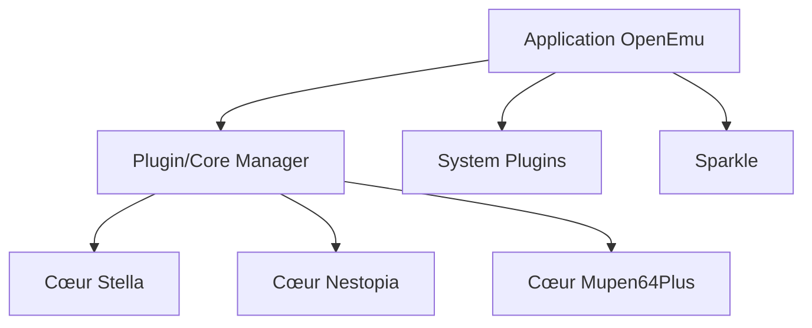

# OpenEmu/OpenEmu

> Native macOS interface for playing on many console emulators, through core plugins.

## The problem
Each emulator has its own interface, settings and formats; on Mac they integrate poorly with the system.

## What it actually does
A Cocoa/Metal/Core Animation front end that loads emulation cores as plugins (Stella, mGBA, Dolphin, Mupen64Plus, Mednafen, Snes9x, etc.) covering more than 30 systems, from the Atari 2600 to the GameCube. Sparkle handles updates; UniversalDetector and XADMaster help with ROM import. It requires macOS Mojave 10.14.4 to run and Xcode 14.3 with Ventura to build.

## How it is wired

## Trying it
The provided README contains no commands.

## Cost and gotchas
Free. No license is declared in the catalog: reuse rights are unknown. ROMs and BIOS files must be obtained legally.

## What it is not
It is not an emulator itself: it assembles third-party cores, each under its own license.

## Alternatives
The README names no alternative.

## For you
Ignore: a macOS gaming tool, with no clear license and unrelated to your work.
