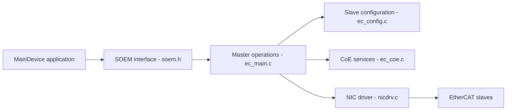

# OpenEtherCATsociety/SOEM

> Lightweight C library for writing a real-time EtherCAT master on embedded systems, Linux or Windows.

## The problem
Communicating with EtherCAT slaves (drives, industrial I/O) requires a real-time protocol stack.

## What it actually does
A library (not an application): public interface `soem.h`, master operations, slave configuration, distributed clocks, CoE, EoE, FoE and SoE services, a system abstraction layer (`osal.h`) and network card drivers for Linux, Windows and RTK. According to the code, some links between protocol stages are not detailed.

## How it is wired

## Trying it
No command in the README: see https://docs.rt-labs.com/soem.

## Cost and gotchas
Free, but the license is present without being identified by GitHub: read it before use. Contributions require a signed Contributor License Agreement.

## What it is not
Not an EtherCAT slave nor a configuration tool: only the master. Very short README.

## Alternatives
None named in the README.

## For you
Ignore: industrial automation, outside data/AI/MLOps except as a gateway to machines.
