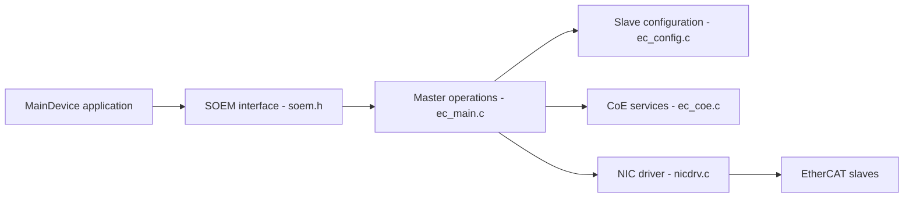

# OpenEtherCATsociety/SOEM

> Bibliothèque C légère pour écrire un maître EtherCAT temps réel sur systèmes embarqués, Linux ou Windows.

## Le problème
Communiquer avec des esclaves EtherCAT (variateurs, E/S industrielles) exige une pile protocolaire temps réel.

## Ce que ça fait vraiment
Bibliothèque (pas une application) : interface publique `soem.h`, opérations maître, configuration des esclaves, horloges distribuées, services CoE, EoE, FoE et SoE, couche d'abstraction système (`osal.h`) et pilotes de carte réseau pour Linux, Windows et RTK. D'après le code, certains liens entre étapes de protocole ne sont pas détaillés.

## Comment c'est branché

## Essayer
Aucune commande dans le README : voir https://docs.rt-labs.com/soem.

## Coût et pièges
Gratuit, mais la licence est présente sans être identifiée par GitHub : à lire avant usage. Les contributions exigent un Contributor License Agreement signé.

## Ce que ce n'est pas
Pas un esclave EtherCAT ni un outil de configuration : seulement le maître. README très court.

## Alternatives
Aucune nommée dans le README.

## Pour toi
Ignorer : automatisme industriel, hors data/IA/MLOps sauf passerelle vers des machines.

