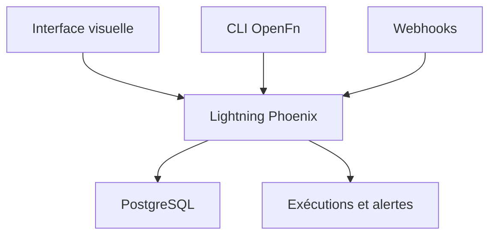

# OpenFn/lightning

> Workflow automation platform for integrating information systems, used by NGOs and governments.

## The problem
Connecting business information systems (health, NGOs) requires fragile, poorly supervised integration scripts.

## What it actually does
Visual interface to build workflows, run tracking with filters, failure alerts and periodic summaries, per-project role management. A CLI lets you build and deploy from an editor. The same product exists self-hosted and as SaaS (app.openfn.org). Written in Elixir and Phoenix with PostgreSQL.

## How it is wired
Simplified diagram based on the sheet, no diagram provided.



## Trying it
```bash
docker compose build && docker compose run --rm web mix ecto.migrate
docker compose up
```

## Cost and gotchas
Docker and PostgreSQL. The demo instance is public and reset every night: nothing private. The SaaS is the commercial model; self-hosting requires server sizing (see the docs).

## What it is not
Not a data pipeline orchestration tool like Airflow: the README talks about business process automation. There is no separate "premium" version according to the README.

## Alternatives
No alternative named in the README.

## For you
Keep an eye on it: useful for information system integrations, but it is not an ML pipeline orchestrator.
