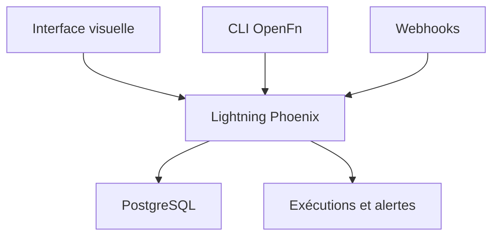

# OpenFn/lightning

> Plateforme d'automatisation de workflows pour intégrer des systèmes d'information, utilisée par des ONG et gouvernements.

## Le problème
Relier des systèmes d'information métier (santé, ONG) demande des scripts d'intégration fragiles et mal supervisés.

## Ce que ça fait vraiment
Interface visuelle pour construire des workflows, suivi des exécutions avec filtres, alertes sur échecs et résumés périodiques, gestion des rôles par projet. Une CLI permet de construire et déployer depuis un éditeur. Le même produit existe en auto-hébergement et en SaaS (app.openfn.org). Écrit en Elixir et Phoenix avec PostgreSQL.

## Comment c'est branché
Schéma simplifié d'après la fiche, sans diagramme fourni.



## Essayer
```bash
docker compose build && docker compose run --rm web mix ecto.migrate
docker compose up
```

## Coût et pièges
Docker et PostgreSQL. L'instance de démo est publique et remise à zéro chaque nuit : rien de privé. Le SaaS est le modèle commercial ; l'auto-hébergement demande du dimensionnement serveur (voir la doc).

## Ce que ce n'est pas
Pas un outil d'orchestration de pipelines de données du type Airflow : le README parle d'automatisation de processus métier. Il n'y a pas de version « premium » à part selon le README.

## Alternatives
Aucune alternative nommée dans le README.

## Pour toi
Surveiller : utile pour des intégrations de systèmes d'information, mais ce n'est pas un orchestrateur de pipelines ML.

