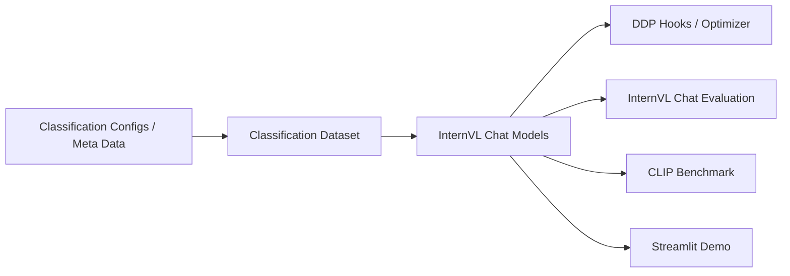

# OpenGVLab/InternVL

> Family of open multimodal vision-language models (1B to 241B) with training and evaluation code.

## The problem
The best vision-language models are closed; open alternatives are needed for multimodal chat, OCR, retrieval or fine-tuning.

## What it actually does
Publishes InternVL 1.0 to 3.5: MLLMs (InternViT + Qwen/InternLM LLM), InternViT encoders, CLIP-type models (InternVL-C/G).
Text chat, single image, multi-image, video, batch inference through Hugging Face `AutoModel` (`trust_remote_code`).
Fine-tuning code (LoRA, MPO), evaluation, classification, segmentation, CLIP benchmarks, Streamlit demo.
Two checkpoint formats (GitHub and HF) with conversion scripts.

## How it is wired

## Trying it
No shell command in the README; only Python examples via `transformers.AutoModel.from_pretrained('OpenGVLab/InternVL2_5-8B', trust_remote_code=True)`.

## Cost and gotchas
Free, MIT. The 8B fits on an A100 80 GB according to the README, larger ones require multi-GPU. `trust_remote_code` runs remote code. Last push September 2025.

## What it is not
Not yet integrated into vLLM/Ollama according to the TODO list. The "GPT-5 alternative" title is marketing.

## Alternatives
None named in the README (numerical comparisons against OpenCLIP, EVA-CLIP, ViT-22B).

## For you
Worth watching: the small sizes (1B-8B) are good VLM bases to fine-tune for OCR or documents, but the repository has been slowing down since 2025.
