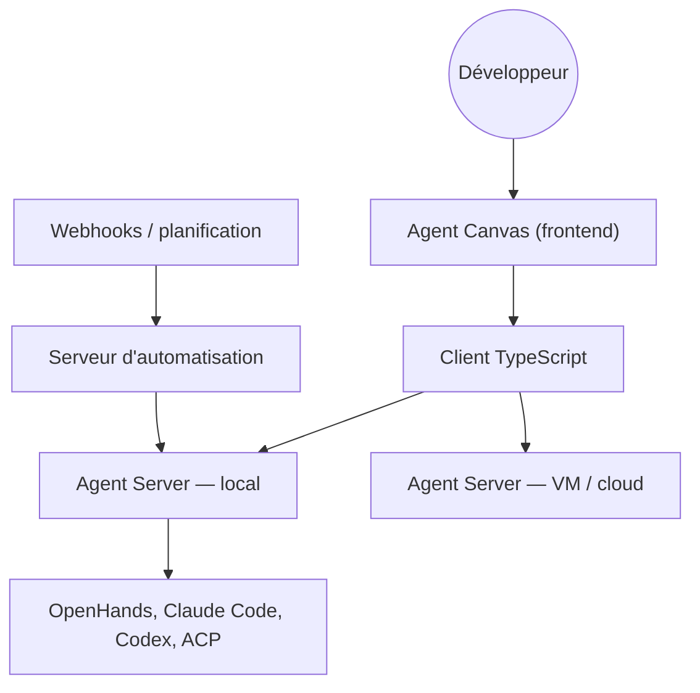

# OpenHands/OpenHands

> Self-hosted code management center for launching and automating agents, regardless of the agent type.

## The problem
The code agents each live within their own terminal, on a single machine, without any planning or coordination.
There is no way to switch between a local agent and a remote agent without losing connection.

## What it actually does
Agent Canvas initiates conversations and automations, and connects to multiple agent backends.
It can execute OpenHands, Claude Code, Codex, Gemini, or any agent using the Agent-Client Protocol (ACP).
Automations triggered by scheduling or webhooks, integrated with Slack, GitHub, Linear, and Notion.
It relies on the Agent Server, a REST API that allows multiple agents to run on a single host.

## How it is wired


## Trying it
```sh
npm install -g @openhands/agent-canvas
agent-canvas
docker run -it --rm -p 8000:8000 -v "$HOME/.openhands:/home/openhands/.openhands" -v "${PROJECTS_PATH}:/projects" ghcr.io/openhands/agent-canvas:1.20.0
```

## Cost and gotchas
The product is free; the templates are your responsibility, and a Cloud/Enterprise offering is available.

Without a sandbox (options 1 and 3), the agent-server has **full access to the machine's file system**.

## What it is not
Not an agent: it's a console that controls agents written elsewhere.
The code is distributed across four repositories – the SDK, the TypeScript client, and the automation – which are not part of this repository.
Not secured by default for network exposure; the README refers to `SELF_HOSTING.md` for hardening.

## Alternatives
- `bytedance/deer-flow`: orchestration of sub-agents and sandboxes, designed as a single, unified platform.
- `NousResearch/hermes-agent`: A permanent, self-hosted agent without a multi-backend console.

## For you
This is relevant if you are running multiple agents on a single server; the option without a sandbox should be avoided.
