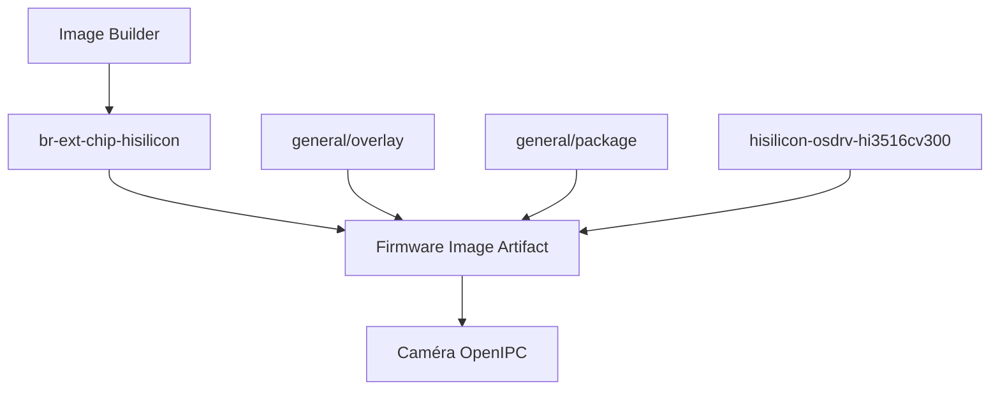

# OpenIPC/firmware

> Open Buildroot-based firmware to replace the software on IP cameras, for tinkerers and integrators.

## The problem
IP cameras run closed proprietary firmware that is rarely updated and hardly configurable.

## What it actually does
A Buildroot distribution that composes a firmware image from per-chip profiles (HiSilicon, Goke, Ingenic, SigmaStar, and others), a common filesystem overlay and a package catalog (Majestic, go2rtc, network utilities, PTZ). Ships vendor drivers and a musl ABI compatibility layer. The complete build wiring is not documented in the sources provided.

## How it is wired

## Trying it
No command documented in the README: it points to the website, the wiki and CLAUDE.md for building.

## Cost and gotchas
Free, funded by donations. Needs a camera with a supported chip and a Buildroot toolchain; flashing a firmware can brick the camera. The choice of packages per board is not established by the sources.

## What it is not
Not an installable application: it is a distribution to build and flash. Not a turnkey AI vision solution.

## Alternatives
No alternative named in the README.

## For you
Ignore: embedded firmware for cameras, outside your data/AI/MLOps scope unless you have an edge video project.
