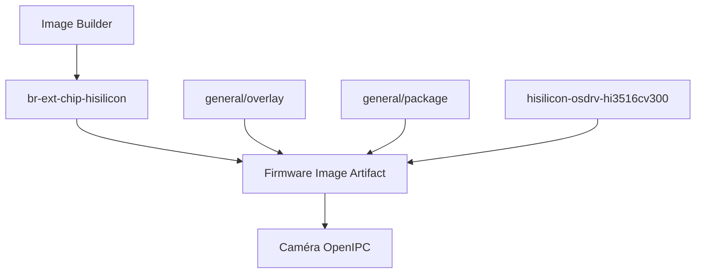

# OpenIPC/firmware

> Firmware libre basé sur Buildroot pour remplacer le logiciel des caméras IP, pour bricoleurs et intégrateurs.

## Le problème
Les caméras IP tournent sur des firmwares propriétaires fermés, rarement mis à jour et peu configurables.

## Ce que ça fait vraiment
Distribution Buildroot qui compose une image firmware à partir de profils par puce (HiSilicon, Goke, Ingenic, SigmaStar, et d'autres), d'un overlay de système de fichiers commun et d'un catalogue de paquets (Majestic, go2rtc, utilitaires réseau, PTZ). Embarque des pilotes fournisseurs et une couche de compatibilité ABI musl. Le câblage de build complet n'est pas documenté dans les sources fournies.

## Comment c'est branché

## Essayer
Aucune commande documentée dans le README : il renvoie au site, au wiki et à CLAUDE.md pour construire.

## Coût et pièges
Gratuit, financement par dons. Besoin d'une caméra à puce supportée et d'une chaîne Buildroot ; flasher un firmware peut rendre la caméra inutilisable. Le choix des paquets par carte n'est pas établi par les sources.

## Ce que ce n'est pas
Ce n'est pas une application installable : c'est une distribution à construire et à flasher. Pas une solution de vision IA clé en main.

## Alternatives
Aucune alternative nommée dans le README.

## Pour toi
À ignorer : firmware embarqué pour caméras, hors de ton périmètre data/IA/MLOps sauf projet vidéo en périphérie.

