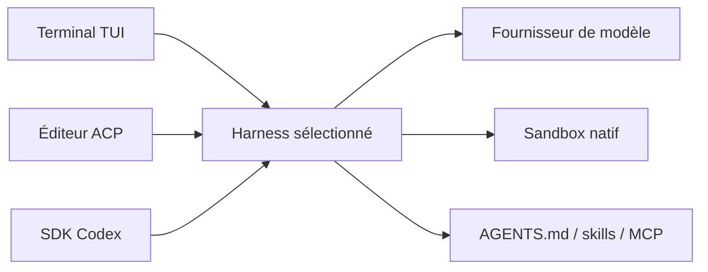

# OpenInterpreter/open-interpreter

> Terminal coding agent, rewritten in Rust from Codex, that imitates the "harnesses" of other agents.

## The problem
Cheap models perform poorly in an agent designed for another model. Switching provider or editor forces you to switch tools.

## What it actually does
A fork of OpenAI's Codex, it offers `/harness` to emulate the agent loop of other tools (claude-code, kimi-code, qwen-code, swe-agent, minimal…). It switches model with `/model`, runs commands in a native sandbox (macOS, Linux, Windows), speaks ACP for editors and reuses `AGENTS.md`, `.agents/skills` and MCP. It ships a QA skill for testing web or native interfaces.

## How it is wired
The diagram provided describes the old Python version (LiteLLM, FastAPI) and no longer matches the Rust README; diagram drawn from the README:


## Trying it
```bash
curl -fsSL https://www.openinterpreter.com/install | sh
interpreter
```

## Cost and gotchas
You need credentials from a model provider (documented elsewhere, not read). The install script is a `curl | sh`. Token costs are on you.

## What it is not
Not the original Python project: that one lives on in a community fork (endolith/open-interpreter). The architecture diagram provided is outdated. Governance is not specified in the README.

## Alternatives
OpenAI's Codex (of which this is a fork); endolith/open-interpreter for the original Python version.

## For you
To watch: interesting for testing cheap models in several harnesses, but the project has changed nature and installing via script calls for caution.
