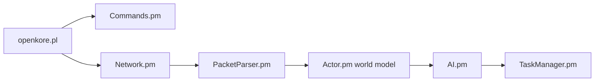

# OpenKore/openkore

> Custom client and automated assistant in Perl for Ragnarok Online, cross-platform.

## The problem
Automating repetitive actions (combat, movement) in Ragnarok Online.

## What it actually does
Perl client that speaks the server protocol, maintains a world model and decides through an AI loop driven by `control/config.txt`. Task planner, native XS pathfinding, plugins (macro, eventMacro), console or wx interface, XKore proxy modes. The README table says "Not working" on all the listed official servers.

## How it is wired


## Trying it
```bash
git clone https://github.com/OpenKore/openkore.git
perl openkore.pl
```

## Cost and gotchas
Free. The bot does not work on any listed official server (anti-cheat protections); ban risk not documented. License present but not identified by GitHub.

## What it is not
Not a productivity tool: it is a game bot, mostly usable on private servers.

## Alternatives
No alternative named in the README.

## For you
Ignore: a game bot unrelated to your field, non-functional on official servers.
