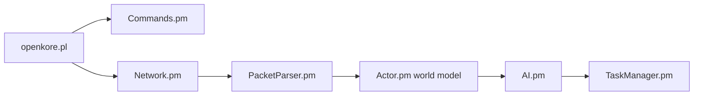

# OpenKore/openkore

> Client personnalisé et assistant automatisé en Perl pour Ragnarok Online, multiplateforme.

## Le problème
Automatiser des actions répétitives (combat, déplacement) dans Ragnarok Online.

## Ce que ça fait vraiment
Client Perl qui parle le protocole du serveur, maintient un modèle du monde et décide via une boucle d'IA pilotée par `control/config.txt`. Planificateur de tâches, pathfinding natif XS, plugins (macro, eventMacro), interface console ou wx, modes proxy XKore. Le tableau du README indique « Not working » sur tous les serveurs officiels listés.

## Comment c'est branché


## Essayer
```bash
git clone https://github.com/OpenKore/openkore.git
perl openkore.pl
```

## Coût et pièges
Gratuit. Le bot ne fonctionne sur aucun serveur officiel listé (protections anti-triche) ; risque de bannissement non documenté. Licence présente mais non identifiée par GitHub.

## Ce que ce n'est pas
Pas un outil de productivité : c'est un bot de jeu, utilisable surtout sur des serveurs privés.

## Alternatives
Aucune alternative nommée dans le README.

## Pour toi
À ignorer : bot de jeu sans rapport avec ton métier, inopérant sur les serveurs officiels.

