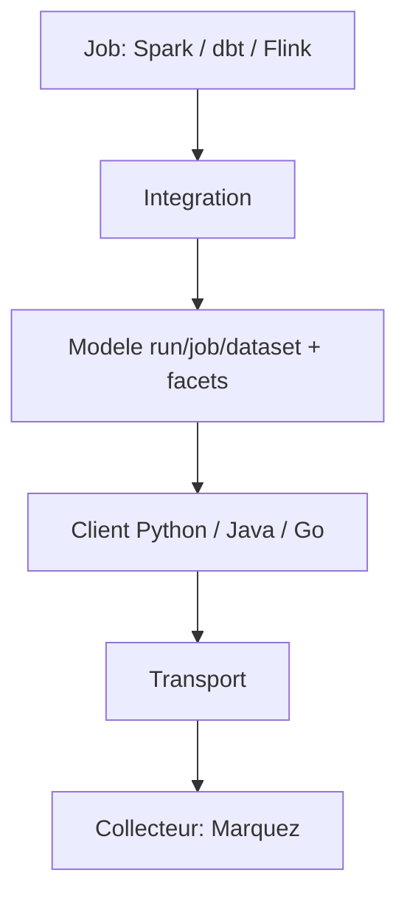

# OpenLineage/OpenLineage

> Open standard and libraries for collecting lineage of jobs, runs and datasets.

## The problem
Every project has to instrument its jobs to trace lineage, and external integrations break with each version.

## What it actually does
Defines a model (run, job, dataset) extended by facets, an OpenAPI specification, and Python, Java and Go clients that emit events to a configurable backend. Integrations for Spark, Airflow, dbt, Flink. Marquez is the reference implementation. LF AI & Data project (Graduate).

## How it is wired

## Trying it
No command documented in this README; it points to the integrations documentation.

## Cost and gotchas
Free. You need a collection backend (Marquez or other) to make use of the events. 411 open issues; vulnerability reporting through an issue labeled "security".

## What it is not
Not a data catalog nor an interface: a standard and event emitters.

## Alternatives
- Marquez: collection, aggregation and visualization (reference implementation).
- Egeria: enterprise metadata and governance.

## For you
Adopt: a foundation-backed lineage standard, directly useful for tracing Spark, dbt and Airflow pipelines.
