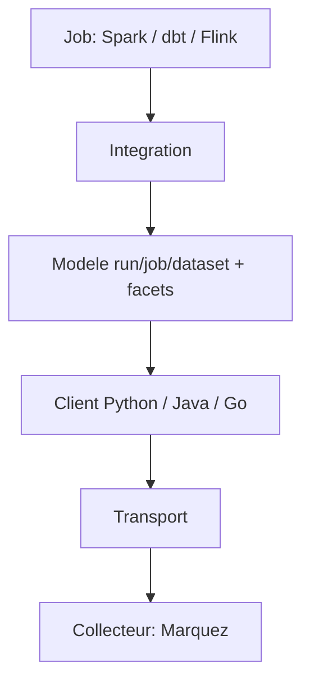

# OpenLineage/OpenLineage

> Standard ouvert et bibliothèques pour collecter la lignée de jobs, runs et jeux de données.

## Le problème
Chaque projet doit instrumenter ses jobs pour tracer la lignée, et les intégrations externes cassent à chaque version.

## Ce que ça fait vraiment
Définit un modèle (run, job, dataset) étendu par des facets, une spécification OpenAPI, et des clients Python, Java et Go qui émettent des événements vers un backend configurable. Intégrations pour Spark, Airflow, dbt, Flink. Marquez en est l'implémentation de référence. Projet LF AI & Data (Graduate).

## Comment c'est branché

## Essayer
Aucune commande documentée dans ce README ; renvoi à la documentation des intégrations.

## Coût et pièges
Gratuit. Il faut un backend de collecte (Marquez ou autre) pour exploiter les événements. 411 issues ouvertes ; signalement de vulnérabilité par issue étiquetée « security ».

## Ce que ce n'est pas
Pas un catalogue de données ni une interface : un standard et des émetteurs d'événements.

## Alternatives
- Marquez : collecte, agrégation et visualisation (implémentation de référence).
- Egeria : métadonnées et gouvernance d'entreprise.

## Pour toi
À adopter : standard de lignée adossé à une fondation, directement utile pour tracer pipelines Spark, dbt et Airflow.

