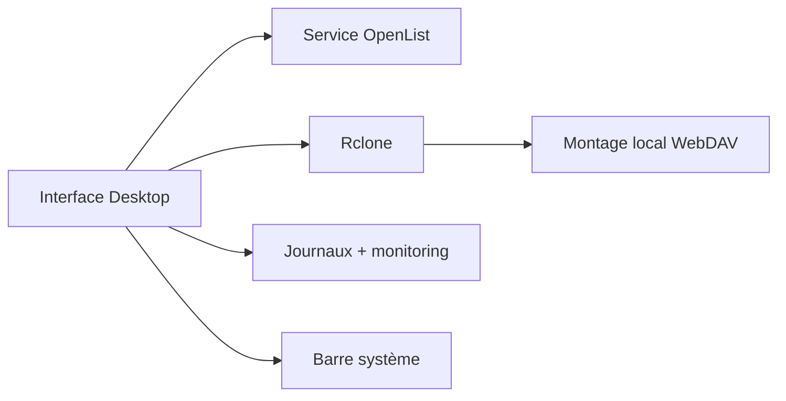

# OpenListTeam/OpenList-Desktop

> Tauri desktop application to manage OpenList and mount WebDAV cloud storage via Rclone.

## The problem
Driving the OpenList service and mounting cloud storage locally requires the command line.

## What it actually does
Starts, stops and monitors the OpenList core, mounts WebDAV storage with Rclone, displays status, logs and performance, integrates a system tray icon, updates and starts automatically. Customizable Rclone options (`--vfs-cache-mode=full`, etc.). Version 0.x: the README warns of major changes. README in Chinese.

## How it is wired


## Trying it
```bash
winget install OpenListTeam.OpenListDesktop
git clone https://github.com/OpenListTeam/openlist-desktop.git
yarn install
yarn run prebuild:dev
yarn run tauri build
```

## Cost and gotchas
Free; cloud storage depends on the providers. Early stage, instabilities possible.

## What it is not
Not the OpenList service itself: a control interface.

## Alternatives
No alternative named in the README.

## For you
Ignore: cloud mount manager that is still unstable, with no direct link to data/AI/MLOps.
