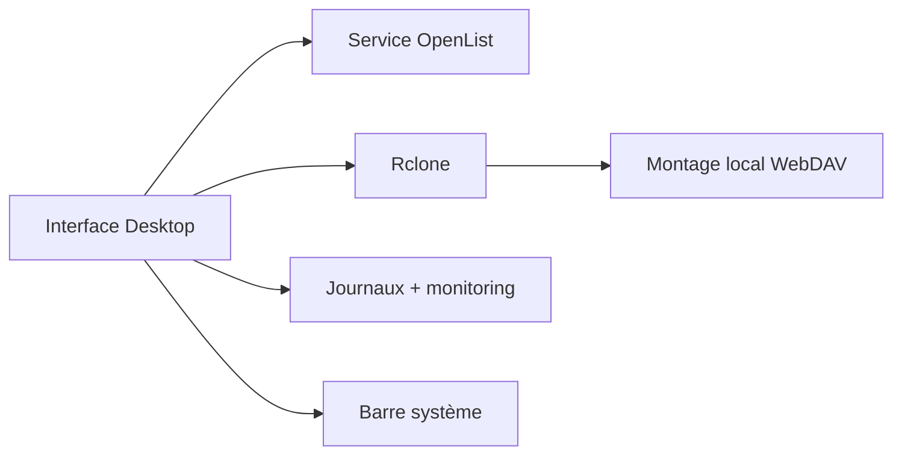

# OpenListTeam/OpenList-Desktop

> Application de bureau Tauri pour gérer OpenList et monter du stockage cloud WebDAV via Rclone.

## Le problème
Piloter le service OpenList et monter des stockages cloud localement demande de la ligne de commande.

## Ce que ça fait vraiment
Démarre, arrête et surveille le cœur OpenList, monte des stockages WebDAV avec Rclone, affiche l'état, les journaux et la performance, intègre une icône de barre système, met à jour et démarre automatiquement. Options Rclone personnalisables (`--vfs-cache-mode=full`, etc.). Version 0.x : le README prévient de changements majeurs. README en chinois.

## Comment c'est branché


## Essayer
```bash
winget install OpenListTeam.OpenListDesktop
git clone https://github.com/OpenListTeam/openlist-desktop.git
yarn install
yarn run prebuild:dev
yarn run tauri build
```

## Coût et pièges
Gratuit ; les stockages cloud dépendent des fournisseurs. Stade précoce, instabilités possibles.

## Ce que ce n'est pas
Pas le service OpenList lui-même : une interface de pilotage.

## Alternatives
Aucune alternative nommée dans le README.

## Pour toi
À ignorer : gestionnaire de montages cloud encore instable, sans lien direct avec data/IA/MLOps.

