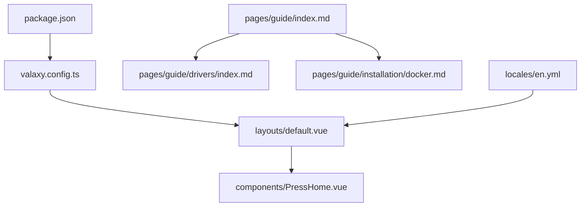

# OpenListTeam/OpenList-Docs

> Official documentation site for OpenList, a web file manager that replaces AList.

## The problem
OpenList users need up-to-date documentation on installation and storage drivers.

## What it actually does
A site built with Valaxy and its press theme. The content is in Markdown (guide, storage drivers, Docker installation), dressed up with Vue layouts, components and translations. It replaces the old documentation based on AList Docs.

## How it is wired


## Trying it
```bash
git clone https://github.com/OpenListTeam/OpenList-Docs.git
cd OpenList-Docs
pnpm install
pnpm dev
```

## Cost and gotchas
Node 18+ and pnpm. The local server listens on port 4859. AGPL-3.0 license (strong copyleft).

## What it is not
Not OpenList itself: only its documentation site.

## Alternatives
The old documentation (OpenList Docs Legacy, based on AList Docs) is mentioned as the previous version.

## For you
Ignore: documentation for a file manager, with no direct use in data or AI.
