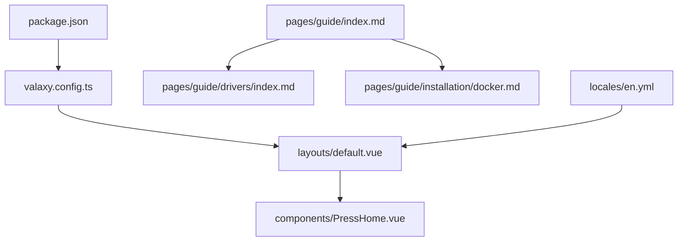

# OpenListTeam/OpenList-Docs

> Site de documentation officiel d'OpenList, gestionnaire de fichiers web remplaçant AList.

## Le problème
Les utilisateurs d'OpenList ont besoin d'une documentation à jour sur l'installation et les pilotes de stockage.

## Ce que ça fait vraiment
Un site construit avec Valaxy et son thème press. Le contenu est en Markdown (guide, pilotes de stockage, installation Docker), habillé par des mises en page Vue, des composants et des traductions. Il remplace l'ancienne documentation basée sur AList Docs.

## Comment c'est branché


## Essayer
```bash
git clone https://github.com/OpenListTeam/OpenList-Docs.git
cd OpenList-Docs
pnpm install
pnpm dev
```

## Coût et pièges
Node 18+ et pnpm. Le serveur local écoute sur le port 4859. Licence AGPL-3.0 (copyleft fort).

## Ce que ce n'est pas
Pas OpenList lui-même : seulement son site de documentation.

## Alternatives
L'ancienne documentation (OpenList Docs Legacy, basée sur AList Docs) est citée comme version précédente.

## Pour toi
À ignorer : documentation d'un gestionnaire de fichiers, sans usage direct en data ou IA.

