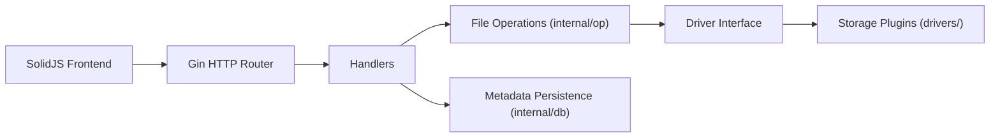

# OpenListTeam/OpenList

> Web server that lists and shares files stored across many network drives and clouds.

## The problem
Files are scattered across several storages (personal cloud, S3, FTP, WebDAV...), with no single interface to browse them.

## What it actually does
Aggregates more than 40 storages (Aliyundrive, OneDrive, Google Drive, S3, WebDAV, SMB, etc.) behind a web interface: file preview, gallery, video/audio, Office documents, upload, offline download, copy between storages, dark mode. From the code: Go/Gin backend, SolidJS frontend, a `drivers/` layer per storage, and a SQL metadata database. The README specifies that it only does 302 redirects or traffic forwarding.

## How it is wired

## Trying it
No command documented in the README provided; the README points to the online documentation.

## Cost and gotchas
Free, but depends on third-party accounts (account blocks or rate limits are on you, says the README). AGPL-3.0: obligation to publish modifications served over a network. Beware of derivatives with a similar name.

## What it is not
It is not a synchronization or backup tool. It is not affiliated with any storage provider.

## Alternatives
No alternative named in the README (the code is presented as a fork of alist).

## For you
Ignore for a data/AI profile: a personal file-sharing tool, unrelated to your field; the AGPL also complicates any use in a company.
