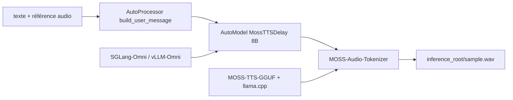

# OpenMOSS/MOSS-TTS

> Family of open speech synthesis models: long-form narration, dialogue, real-time, sound effects.

## The problem
A single TTS model rarely handles length, voice cloning and multi-speaker dialogue.
You end up stacking three incompatible models.

## What it actually does
Five separate models: MOSS-TTS (zero-shot cloning, pinyin/phoneme/duration control), MOSS-TTSD (dialogue),
MOSS-VoiceGenerator (voice designed from text, no reference), MOSS-TTS-Realtime (advertised TTFB of 180 ms),
MOSS-SoundEffect (sound effects). Two architectures: `MossTTSDelay` and `MossTTSLocal`, plus `MossTTSRealtime`.
A PyTorch-free inference path via llama.cpp and ONNX Runtime, and serving via SGLang-Omni or vLLM-Omni.

## How it is wired


## Trying it
```bash
git clone https://github.com/OpenMOSS/MOSS-TTS.git
cd MOSS-TTS
uv venv --python 3.12 .venv
source .venv/bin/activate
uv pip install --torch-backend cu128 -e ".[torch-runtime]"
```

## Cost and gotchas
CUDA GPU expected (`torch==2.9.1+cu128` pinned); ffmpeg required by `torchcodec`.
The flagship model is 8B: budget for VRAM, or use the GGUF/ONNX profile for a modest machine.

## What it is not
Not a ready-to-use service: you have to download the weights and set up your own server.
Not a single model — choosing the right variant is part of the work.
TensorRT engines are not provided: they are built on your machine.

## Alternatives
CosyVoice3, FishAudio-S1, DiTAR and Seed-TTS, cited as comparisons in the Seed-TTS-eval evaluation.

## For you
The open family to test if you have a serious TTS need and a decent card; otherwise too heavy.
