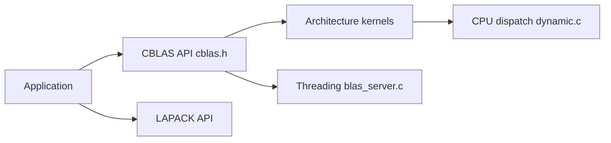

# OpenMathLib/OpenBLAS

> BLAS and LAPACK library optimized per CPU architecture, for numerical computing.

## The problem
Matrix products and factorizations are slow if the code does not exploit the instructions specific to each processor.

## What it actually does
Provides the BLAS (levels 1 to 3), CBLAS and LAPACK interfaces, with kernels optimized per target (x86 AVX/AVX2/AVX512, ARM64, POWER, RISC-V, LoongArch, WASM). Runtime CPU detection (`dynamic.c`), thread server (`blas_server.c`), memory management (`memory.c`).

## How it is wired


## Trying it
```bash
make
make TARGET=NEHALEM
make install PREFIX=your_installation_directory
export OPENBLAS_NUM_THREADS=4
```

## Cost and gotchas
Free. C compiler, Make or CMake; Fortran optional. Repeat the options on `make install`. Thread variable priority: OPENBLAS > GOTO > OMP.

## What it is not
Not a GPU library. Not a high-level API: it is what NumPy or SciPy call underneath (not specified by the README).

## Alternatives
The netlib reference implementation (BLAS/LAPACK) is cited; slower.

## For you
Adopt; often already present under NumPy; useful to know for tuning threads and CPU targets in production.
