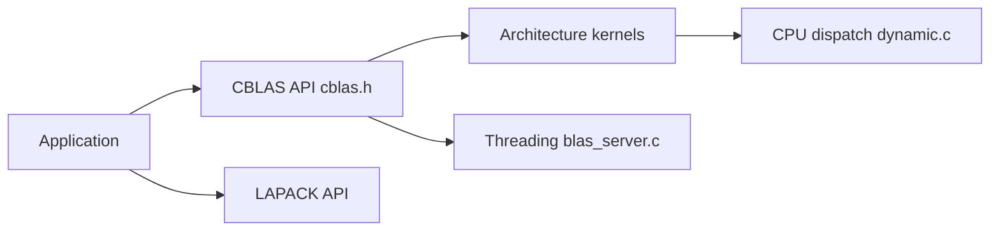

# OpenMathLib/OpenBLAS

> Bibliothèque BLAS et LAPACK optimisée par architecture CPU, pour le calcul numérique.

## Le problème
Les produits matriciels et factorisations sont lents si le code n'exploite pas les instructions spécifiques à chaque processeur.

## Ce que ça fait vraiment
Fournit les interfaces BLAS (niveaux 1 à 3), CBLAS et LAPACK, avec noyaux optimisés par cible (x86 AVX/AVX2/AVX512, ARM64, POWER, RISC-V, LoongArch, WASM). Détection du CPU à l'exécution (`dynamic.c`), serveur de threads (`blas_server.c`), gestion mémoire (`memory.c`).

## Comment c'est branché


## Essayer
```bash
make
make TARGET=NEHALEM
make install PREFIX=your_installation_directory
export OPENBLAS_NUM_THREADS=4
```

## Coût et pièges
Gratuit. Compilateur C, Make ou CMake ; Fortran optionnel. Répéter les options au `make install`. Priorité des variables de threads : OPENBLAS > GOTO > OMP.

## Ce que ce n'est pas
Pas une bibliothèque GPU. Pas une API de haut niveau : c'est ce que NumPy ou SciPy appellent en dessous (non précisé par le README).

## Alternatives
Implémentation de référence netlib (BLAS/LAPACK) citée ; plus lente.

## Pour toi
À adopter, souvent déjà présent sous NumPy ; utile à connaître pour régler threads et cibles CPU en production.

