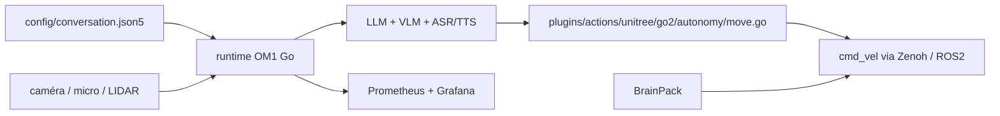

# OpenMind/OM1

> Modular runtime for multimodal AI agents on robots and simulated environments, for roboticists.

## The problem
Rewiring perception, LLM and actions for each physical robot form is wasted work.
Going from a quadruped to a humanoid means reconfiguring everything.

## What it actually does
A Go runtime (the Python one is deprecated and unmaintained): inputs from web, social networks, camera, LIDAR;
outputs for movement, autonomous navigation, conversation. Hardware plugins to ROS2, Zenoh and CycloneDDS
(Zenoh recommended). Preconfigured TTS and LLM endpoints (OpenAI, xAI, DeepSeek, Anthropic, Meta, Gemini,
NearAI, local Ollama) and several VLMs. A Prometheus + Grafana stack is provided for LLM and ASR latencies.
Agents are described in `json5` files combining `inputs` and `actions`; connectors live under `plugins/actions/`.
Full autonomy (navigation, SLAM, recharging, face anonymization) with the BrainPack, on
Unitree Go2/G1, Deep Robotics M20 Pro and LimX Tron. Gazebo and Isaac Sim supported.

## How it is wired


## Trying it
```bash
sudo apt-get install -y portaudio19-dev ffmpeg pkg-config
export OM_API_KEY="<your_api_key>"
./om1 -config ./config/conversation.json5
git clone https://github.com/OpenMind/OM1.git && make deps && make build
CONFIG=conversation make run
docker-compose up -d grafana prometheus
```

## Cost and gotchas
An OpenMind API key is mandatory; billing is in OMCU, with a free plan of 50 OMCU per month, renewed.
The Go runtime does not yet cover everything the Python one did. Building from source: Go 1.25+.
On macOS, Gatekeeper and the microphone/camera permissions must be unlocked by hand.

## What it is not
It is not a hardware abstraction layer: OM1 assumes the robot already provides a high-level
SDK accepting commands like `move(0.37, 0, 0)`. Without a HAL, you have to build it
(RL, simulation, VLA) — the README says so explicitly. It is not offline: the API key is a required step.

## Alternatives
Unitree's C++ SDK, cited as an example of an advanced humanoid HAL.

## For you
Relevant only if you touch robotics; the Zenoh + json5 + Grafana triptych is well thought out.
