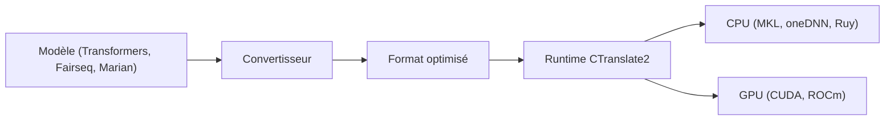

# OpenNMT/CTranslate2

> Fast and efficient C++ and Python inference engine for Transformer models, on CPU and GPU.

## The problem
General-purpose frameworks use a lot of memory and run slowly for Transformer inference.

## What it actually does
A dedicated runtime applies quantization (FP16, BF16, INT16, INT8, INT4 AWQ), layer fusion and batch reordering. It supports encoder-decoder models (NLLB, Whisper, T5), decoder-only models (Llama, Mistral, Gemma, Qwen2) and encoder-only models (BERT). It selects CPU backends at runtime and supports tensor parallelism.

## How it is wired

Simplified diagram based on the sheet, no diagram provided.

## Trying it
```bash
pip install ctranslate2
# Python :
# translator = ctranslate2.Translator(translation_model_path)
# translator.translate_batch(tokens)
```

## Cost and gotchas
Free. Models must be converted first. The README's benchmarks date from version 3.6.0 and a specific configuration; ROCm requires dedicated wheels.

## What it is not
It is not a training framework nor a ready-to-use server: it serves inference. TTS support (Drama 3) is experimental.

## Alternatives
No named alternative, but the README compares OpenNMT-py, OpenNMT-tf, Marian, FasterTransformer and Transformers in its benchmarks.

## For you
Adopt: if you serve Transformer or Whisper models, it is a measured gain in speed and memory, installable with pip.
